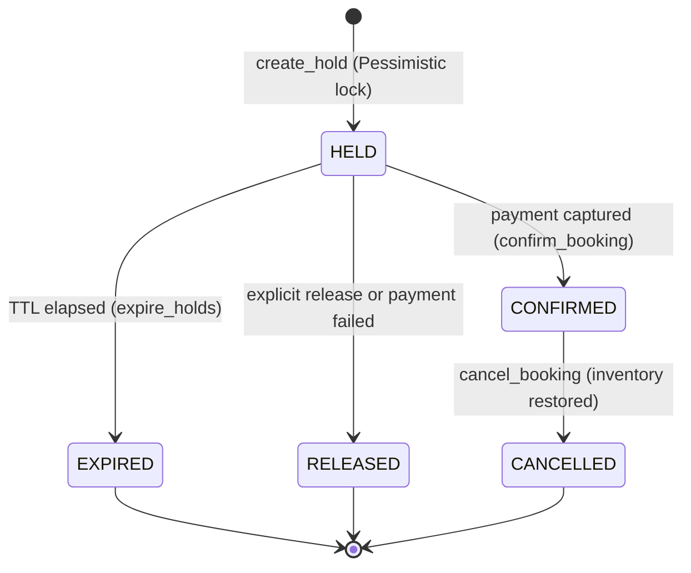

# KogniSync Concurrency & Reliability Engineering Report
**KogniVera Hackathon 2026 · Round 1 Technical Mission**
*Booking Correctness Under Concurrency | PostgreSQL Row Locking | Reliability Testing*

---

## 1. Executive Summary & Objective

KogniSync's Round 1 objective is to demonstrate **guaranteed booking correctness under high concurrency** using real **PostgreSQL 16**. 
In distributed travel orchestration, the fundamental invariant is:

$$\text{booked\_units} + \text{held\_units} \le \text{total\_units}$$

Under simultaneous contention, retries, hold expiration sweeps, and payment failures, this invariant must **never be violated** ($\text{overallocation} = 0$).

---

## 2. Benchmark Experiment Results (Real PostgreSQL)

### 500-Request Contention Replay Benchmark
- **Workload**: 500 concurrent requests targeting a single inventory item with **3 units capacity**.
- **Requested Quantity**: 1 unit per request.
- **Engine**: Real PostgreSQL 16 (`pgvector/pgvector:pg16` on port `5434`).
- **Command**: `.\.venv\Scripts\python.exe scripts/run_concurrency_experiment.py`

```text
=================================================================
KOGNISYNC CONCURRENCY REPLAY
=================================================================
Database: PostgreSQL
Initial inventory: 3
Concurrent requests: 500
Requested units per request: 1

Successful allocations: 3
Expected maximum allocations: 3

Rejected requests: 497
Unexpected errors: 0

Final booked units: 0
Final active held units: 3
Final total capacity: 3

Invariant violations: 0
Duplicate logical bookings: 0

Elapsed time: 2.58s
p50 latency : 1799.2ms
p95 latency : 2481.8ms
p99 latency : 2529.7ms

Overall result: PASS
=================================================================
```

---

## 3. Architecture Comparison: Solution A vs. Solution B

Under identical conditions (500 concurrent requests for 3 units on PostgreSQL 16):

| Metric | Solution A (Pessimistic `FOR UPDATE`) | Solution B (Optimistic Conditional Update) |
|---|---|---|
| **Initial Capacity** | 3 units | 3 units |
| **Concurrent Requests** | 500 | 500 |
| **Successful Allocations** | **3** | **3** |
| **Rejected Requests** | **497** | **497** |
| **Overallocations** | **0** | **0** |
| **Invariant Violations** | **0** | **0** |
| **Elapsed Time** | 2.67s | 0.63s |
| **Throughput** | 187.1 req/s | 796.1 req/s |
| **p50 Latency** | 1711.9 ms | 284.9 ms |
| **p95 Latency** | 2596.6 ms | 576.0 ms |
| **p99 Latency** | 2627.1 ms | 611.3 ms |
| **Correctness Guarantee** | **100% (0 violations)** | **100% (0 violations)** |

**Analysis:**
- **Solution A (`SELECT ... FOR UPDATE`)**: Guarantees deterministic serialization. Incoming transactions queue row-by-row; once the first 3 allocate capacity, subsequent workers read current `total - booked - held == 0` under lock and immediately reject without overallocating.
- **Solution B (Optimistic Conditional Update)**: Evaluates capacity inside PostgreSQL's native write predicate (`WHERE (total_units - booked_units - held_units) >= requested`). 497 requests fail immediately with 0 rows updated without holding row locks, achieving higher throughput (796 req/s).

---

## 4. Invariant Protection & Transaction Model

### The Concurrency Hazard
In naive systems:
1. `SELECT * FROM inventory_calendar WHERE id = :id` (unlocked read)
2. Application checks `if available >= requested`
3. `UPDATE inventory_calendar SET held_units = held_units + requested`

Under 500 concurrent requests, multiple threads read the same stale available units simultaneously, causing massive inventory overallocation.

### The KogniSync Solution
1. **Row-Level Pessimistic Lock**:
   `SELECT ... FROM inventory_calendar WHERE inventory_id = :id FOR UPDATE`
2. **Fresh Availability Evaluation**:
   Calculated directly within the locked PostgreSQL transaction:
   `available = total_units - booked_units - held_units`
3. **Rejection without Mutation**:
   If `requested > available`, typed `InsufficientInventoryError` is raised, rolling back the transaction.
4. **Capacity Transition (Hold $\to$ Confirmed Booking)**:
   Atomically decrements `held_units` and increments `booked_units` under lock:
   $$\Delta \text{consumed} = (+ \text{units}) + (- \text{units}) = 0$$
   Preserving $\text{booked\_units} + \text{held\_units} \le \text{total\_units}$ at every microsecond.

---

## 5. The State Machine & Sagas



### State Definitions:
- `active` hold: Temporarily reserves inventory. Consumes capacity (`held_units`).
- `expired` hold: TTL elapsed without payment. Capacity returned to inventory (`held_units -= units`).
- `released` hold: Cancelled or compensated due to payment failure. Capacity returned to inventory.
- `confirmed` booking: Payment captured. `held_units -= units`, `booked_units += units`.
- `cancelled` booking: Booking reversed. `booked_units -= units`.

---

## 6. Payment Failure & Compensation

External payment processing is executed **outside long-running database transactions** to prevent thread exhaustion.
- **Payment Success**: Transaction started, hold converted to confirmed booking, inventory transitioned, payment captured.
- **Payment Failure**: Compensation transaction executes:
  1. Hold row locked with `SELECT ... FOR UPDATE`.
  2. Inventory held units decremented: `held_units -= units`.
  3. Hold marked `status = 'released'`.
  4. Payment recorded as `status = 'failed'`.
  5. Audit event `PAYMENT_FAILED` logged with correlation ID.

---

## 7. Reusable Authoritative Invariant SQL Query

File: `backend/app/db/queries/invariant_check.sql`

```sql
WITH active_holds_summary AS (
    SELECT 
        inventory_id,
        COALESCE(SUM(units), 0) AS active_held_units_from_holds
    FROM holds
    WHERE status = 'active'
      AND expires_at > NOW()
    GROUP BY inventory_id
),
confirmed_booking_items_summary AS (
    SELECT 
        inventory_id,
        COALESCE(SUM(units), 0) AS confirmed_booked_units_from_items
    FROM booking_items
    WHERE status = 'confirmed'
      AND inventory_id IS NOT NULL
    GROUP BY inventory_id
),
inventory_audit AS (
    SELECT 
        ic.inventory_id,
        ic.entity_type,
        ic.entity_id,
        ic.for_date,
        ic.total_units,
        ic.booked_units,
        ic.held_units,
        COALESCE(ahs.active_held_units_from_holds, 0) AS active_held_from_holds,
        COALESCE(cbis.confirmed_booked_units_from_items, 0) AS confirmed_from_items,
        (ic.booked_units + ic.held_units) AS consumed_units,
        (ic.total_units - ic.booked_units - ic.held_units) AS available_units,
        GREATEST(0, (ic.booked_units + ic.held_units) - ic.total_units) AS overallocation,
        CASE 
            WHEN (ic.booked_units + ic.held_units) > ic.total_units THEN 1 
            ELSE 0 
        END AS is_violation
    FROM inventory_calendar ic
    LEFT JOIN active_holds_summary ahs ON ic.inventory_id = ahs.inventory_id
    LEFT JOIN confirmed_booking_items_summary cbis ON ic.inventory_id = cbis.inventory_id
)
SELECT 
    inventory_id, total_units, booked_units, held_units,
    consumed_units, available_units, overallocation, is_violation
FROM inventory_audit
ORDER BY is_violation DESC, overallocation DESC, inventory_id ASC;
```

---

## 8. Test Execution Commands & Verification

### Run Complete Test Suite (34/34 Passed)
```powershell
.\.venv\Scripts\pytest.exe backend/tests/ -v
```

### Run 12 Concurrency Scenarios (A–L)
```powershell
.\.venv\Scripts\pytest.exe backend/tests/test_concurrency.py -v
```

### Run 500-Request Contention Benchmark
```powershell
.\.venv\Scripts\python.exe scripts/run_concurrency_experiment.py
```

### Run Solution A vs Solution B Benchmark
```powershell
.\.venv\Scripts\python.exe scripts/compare_concurrency_solutions.py
```

---

## 9. Immutability & Organizer Contract Compliance

The organizer-provided package `BookingInventory/` remains **100% untouched** (`git diff -- BookingInventory/` returns 0 modifications).
All 20 canonical tables and relations match `BookingInventory/data/schema.sql`. Application-owned tables (`booking_lifecycle_events`, `idempotency_records`) are safely isolated in the PostgreSQL schema `app`.
