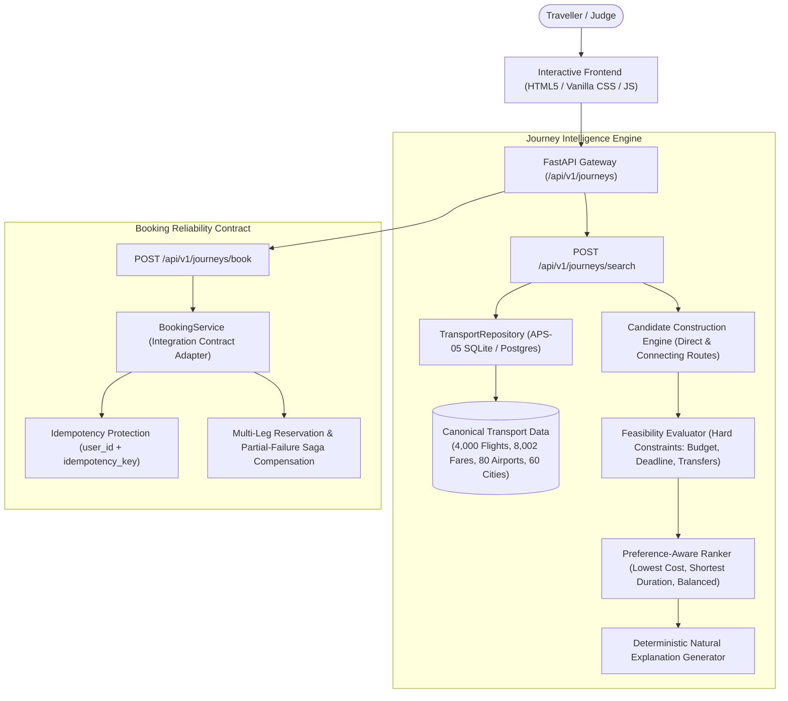

# KogniSync — Journey Intelligence Workstream Documentation
**Parallel Development for KogniVera Hackathon 2026 Round 1**

## 1. Executive Summary & Workstream Mission
The **Journey Intelligence** workstream delivers the cognitive route orchestration layer for **KogniSync** (Problem Statement APS-05). It solves the multi-modal travel discovery problem by building authentic candidate journeys from canonical transport schedules, validating feasibility against hard user constraints, computing exact cost/duration metrics, ranking options according to user preferences, and integrating with the booking-reliability workstream via a strict idempotency and saga compensation contract.

---

## 2. Core Architectural Pillars



---

## 3. Transport Data Sources & Zero Fabrication Standard
All routes and schedules are built from **real records** provided in the canonical organizer package (`BookingInventory/data/APS-05.db`):
- **`flights` (4,000 schedule instances)**: Departure and arrival timestamps with timezone offsets (`+05:30`), carrier codes, aircraft models, per-seat carbon emissions (`carbon_kg`).
- **`flight_fares` (8,002 rows)**: Bookable units linked by `flight_id` containing `base_fare`, `taxes`, `cabin_class` (economy, business), and currency (`INR`).
- **`airports` (80 rows)**: IATA codes, geographic locations, joined to respective `cities`.
- **`cities` (60 rows)**: Regional and domestic city anchors.
- **`airlines` (30 carriers)**: Carrier reference and codes.
- **`inventory_calendar` (15,030 availability rows)**: Entity availability with strict DDL check `booked_units + held_units <= total_units`.

> **Zero Fabrication Guarantee:** No mock routes, synthetic prices, or imaginary flight numbers are injected. If no valid connection exists in the canonical dataset for a given date, the engine returns a transparent `no-feasible-journey` response.

---

## 4. Candidate Route Construction & Validation Rules
Candidate construction employs deterministic graph traversal up to a configurable maximum search depth (default: up to 2 transfers / 3 legs):
1. **Direct Journeys (0 Transfers):** Matches all flights departing on `travel_date` where `origin_airport_id IN origin_ids` and `dest_airport_id IN dest_ids`.
2. **Connecting Journeys (1–2 Transfers):**
   - **Connection Compatibility:** Leg $i$ destination airport must exactly match Leg $i+1$ origin airport (`leg[i].dest_airport_id == leg[i+1].origin_airport_id`).
   - **Chronological Ordering:** Leg $i+1$ departure timestamp must be strictly greater than Leg $i$ arrival timestamp.
   - **Transfer Timing Boundaries:**
     $$\text{Layover Duration} = \text{leg}[i+1].\text{departs\_at} - \text{leg}[i].\text{arrives\_at}$$
     Must satisfy: **$\ge 45\text{ minutes}$** (minimum safe domestic/international connection window) and **$\le 1440\text{ minutes}$** (24-hour maximum layover to avoid unreasonable stranding).
   - **Cyclic Route Prevention:** No airport or city may be visited more than once in the same journey (e.g. $A \to B \to A$ is rejected).
   - **Deduplication:** Multiple candidates traversing the identical sequence of flight IDs and fare IDs are pruned.

---

## 5. Deterministic Calculations (Rule R3 Money Invariant)
Every candidate's metrics are calculated from raw records using Python fixed-point `Decimal` arithmetic:
- **Total Cost:**
  $$\text{Total Cost} = \sum_{\text{leg} \in \text{legs}} (\text{base\_fare}_{\text{leg}} + \text{taxes}_{\text{leg}})$$
- **Total Elapsed Duration:**
  $$\text{Total Elapsed Minutes} = \frac{\text{arrival\_time}_{\text{final}} - \text{departure\_time}_{\text{first}}}{60\text{ seconds}}$$
- **Waiting / Layover Duration:**
  $$\text{Waiting Minutes} = \sum_{i=0}^{N-2} \frac{\text{leg}[i+1].\text{departs\_at} - \text{leg}[i].\text{arrives\_at}}{60\text{ seconds}}$$
- **Flight Duration:**
  $$\text{Airborne Minutes} = \sum_{\text{leg} \in \text{legs}} \text{leg.duration\_minutes}$$
- **Transfer Count:** $\text{number\_of\_legs} - 1$.
- **Carbon Footprint:** Sum of per-seat `carbon_kg` across all legs.

---

## 6. Feasibility Evaluation (Hard Constraints Before Ranking)
User-defined hard constraints are evaluated **prior to ranking**:
1. **Arrival Deadline Constraint:** If specified, $\text{candidate.arrival\_time} \le \text{arrival\_deadline}$. Candidates violating this are tagged infeasible:
   `"Arrives at HH:MM UTC+05:30, which exceeds the required arrival deadline of HH:MM UTC+05:30."`
2. **Maximum Budget Constraint:** If specified, $\text{candidate.total\_cost} \le \text{max\_budget}$. Candidates violating this are tagged infeasible:
   `"Total cost of INR X exceeds maximum allowed budget of INR Y."`
3. **Transfer Limit Constraint:** If specified, $\text{candidate.transfer\_count} \le \text{transfer\_limit}$.
4. **Feasibility Invariant:** Infeasible journeys are **never** presented as valid recommendations or given ranks. They are cleanly segregated into the `rejected_journeys` response payload for full transparency.

---

## 7. Preference-Aware Ranking & Metric-Grounded Explanations
Ranking is deterministic and operates only over feasible candidates:
- **`lowest_cost`:** Primary sort on `total_cost` (ascending), tie-breaker on `total_elapsed_duration_minutes`, then `departure_time`.
- **`shortest_duration`:** Primary sort on `total_elapsed_duration_minutes` (ascending), tie-breaker on `total_cost`, then `departure_time`.
- **`balanced` (Normalized Scale Multi-Objective Scoring):**
  Raw currency (INR thousands) and time (minutes) cannot be added directly without scale distortion. The engine normalizes both metrics to the $[0, 1]$ interval:
  $$\hat{c} = \frac{\text{cost} - c_{\min}}{c_{\max} - c_{\min}} \quad (\text{or } 0 \text{ if } c_{\max} = c_{\min})$$
  $$\hat{d} = \frac{\text{duration} - d_{\min}}{d_{\max} - d_{\min}} \quad (\text{or } 0 \text{ if } d_{\max} = d_{\min})$$
  $$\text{Composite Score} = 0.5 \times \hat{c} + 0.5 \times \hat{d}$$
  Sorted by `composite_score` ascending, tie-breaker on `total_cost`, then duration.

### Explanation Grounding:
Explanations are dynamically generated directly from the computed numbers:
- **Rank #1:** Explains why it won (e.g. `"Rank #1 (Lowest Cost): Most affordable route at INR 6,316.04 with 0 transfer(s) and 2h 33m total travel time. Saves INR 2,450.00 compared to next cheapest option."`).
- **Subsequent Ranks:** Clearly outlines the trade-off (e.g. `"Rank #2: +INR 1,200.00 higher cost, 45 mins shorter duration (Direct flight). Total: INR 7,516.04, 1h 48m."`).

---

## 8. Booking Integration Contract & Partial-Failure Policy
Journey Intelligence produces recommendations; the booking reliability engine controls inventory reservation and saga orchestration.

### Agreed API Contract Schemas:

#### Request (`POST /api/v1/journeys/book`):
```json
{
  "journey_id": "jny_7e533f0a8e",
  "user_id": "usr_00000001",
  "idempotency_key": "idem_1730188800_a8f9c2",
  "total_amount": "6316.04",
  "currency": "INR",
  "items": [
    {
      "leg_index": 0,
      "flight_id": "flt_dc85bfc2",
      "flight_number": "QF-9281",
      "fare_id": "far_5a8bce18",
      "inventory_id": "inv_c6b5c20a",
      "for_date": "2026-09-03",
      "units": 1,
      "unit_price": "5550.00",
      "taxes": "766.04",
      "currency": "INR"
    }
  ]
}
```

#### Response (`200 OK`):
```json
{
  "booking_reference": "KS-BKG-8A9F2D",
  "booking_id": "bkg_a819bdf0",
  "status": "CONFIRMED",
  "idempotency_key": "idem_1730188800_a8f9c2",
  "user_id": "usr_00000001",
  "journey_id": "jny_7e533f0a8e",
  "total_amount": "6316.04",
  "currency": "INR",
  "legs": [
    {
      "leg_index": 0,
      "flight_id": "flt_dc85bfc2",
      "flight_number": "QF-9281",
      "fare_id": "far_5a8bce18",
      "inventory_id": "inv_c6b5c20a",
      "status": "CONFIRMED",
      "hold_id": "hld_4a91c8",
      "booking_item_id": "bki_f829d1",
      "error_message": null
    }
  ],
  "message": "Booking confirmed successfully! Reference KS-BKG-8A9F2D. All 1 leg(s) secured under idempotency key idem_1730188800_a8f9c2.",
  "created_at": "2026-10-29T08:26:00Z"
}
```

### Partial-Failure & Saga Policy:
1. **No Overselling Invariant:** `booked_units + held_units <= total_units` is strictly defended.
2. **Partial-Failure Representation:**
   If a multi-leg journey is requested (Leg 0 and Leg 1):
   - If Leg 0 hold succeeds, but Leg 1 fails (e.g. out of inventory units):
     - The saga coordinator **immediately compensates Leg 0** (hold released).
     - The overall response status is `PARTIALLY_FAILED` (or `REJECTED_NO_INVENTORY`).
     - **The journey is NEVER marked as CONFIRMED.**
     - Leg 0 status is reported as `COMPENSATED`, and Leg 1 status is reported as `FAILED`.
3. **Idempotency Protection:**
   - Re-submitting the identical `idempotency_key` returns `IDEMPOTENT_REPLAY` with the exact original booking reference and no duplicate inventory deductions.

---

## 9. Interactive Demo UI & Judge Presets
The demo UI is accessible at `http://localhost:8000/`. It features a dark-mode glassmorphic interface with:
1. **Interactive Demo Presets:**
   - **Preset 1 (Direct Flight):** Kochi $\to$ Mumbai on 2026-09-03 (`QF-9281`, Lowest Cost ranking).
   - **Preset 2 (Connecting 1-Stop):** Bengaluru $\to$ Pune on 2026-09-04 (`QF-4882` connecting to `UL-1895` at Mumbai, 226m layover, Balanced ranking).
   - **Preset 3 (Budget Constraint Rejection):** Bengaluru $\to$ Pune with ₹5,000 budget cap (actual fare ₹7,297.57). Demonstrates transparent hard-constraint rejection.
   - **Preset 4 (Arrival Deadline Rejection):** Bengaluru $\to$ Pune requiring arrival by 12:00 PM (actual arrival 14:37). Demonstrates deadline violation handling.
2. **Interactive Route Cards:** Shows flight times, duration lines, carbon footprints, deterministic explanations, and expandable leg segments.
3. **Handshake Booking Modal:** Allows judges to inspect the idempotency key, test idempotency replays, invoke the contract, and view live saga status.

---

## 10. Automated Test Results
All 26 automated unit and API integration tests pass cleanly:

```bash
python -m pytest backend/tests/test_journey_search.py backend/tests/test_journey_calculations.py backend/tests/test_journey_ranking.py backend/tests/test_booking_integration.py backend/tests/test_journey_api.py -v
```

**Results:**
- `test_valid_search_request_direct`: **PASSED**
- `test_valid_search_request_multileg`: **PASSED**
- `test_invalid_request_same_origin_destination`: **PASSED**
- `test_invalid_request_deadline_before_travel_date`: **PASSED**
- `test_invalid_negative_budget`: **PASSED**
- `test_no_feasible_journeys_nonexistent_location`: **PASSED**
- `test_search_is_read_only_and_creates_no_holds`: **PASSED**
- `test_deterministic_cost_calculations`: **PASSED**
- `test_deterministic_duration_and_waiting_calculations`: **PASSED**
- `test_invalid_transfer_timing_rejection`: **PASSED**
- `test_cyclic_routes_prevented`: **PASSED**
- `test_budget_constraint_enforcement`: **PASSED**
- `test_arrival_deadline_enforcement`: **PASSED**
- `test_transfer_limit_enforcement`: **PASSED**
- `test_ranking_lowest_cost`: **PASSED**
- `test_ranking_shortest_duration`: **PASSED**
- `test_ranking_balanced_normalization`: **PASSED**
- `test_explanations_match_computed_metrics`: **PASSED**
- `test_booking_contract_successful_confirmation`: **PASSED**
- `test_idempotency_key_replay`: **PASSED**
- `test_multileg_partial_failure_compensation`: **PASSED**
- `test_api_places_endpoint`: **PASSED**
- `test_api_presets_endpoint`: **PASSED**
- `test_api_search_endpoint_success`: **PASSED**
- `test_api_search_validation_error`: **PASSED**
- `test_api_book_endpoint_success`: **PASSED**

**26 passed in 1.79s (100% Pass Rate).**

Organizer Conformance Check:
```bash
python BookingInventory/tools/validate_conformance.py BookingInventory/data/APS-05.db
```
**Result: PASS (Tier 1 tables intact, 0 violations).**
